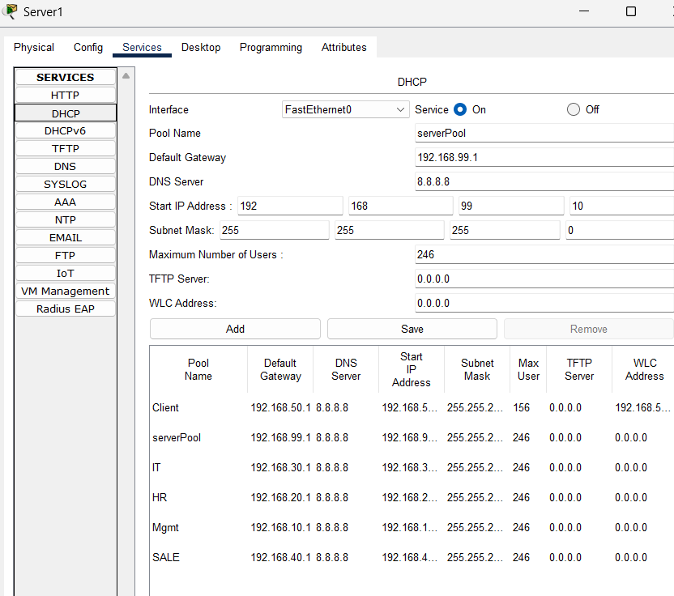
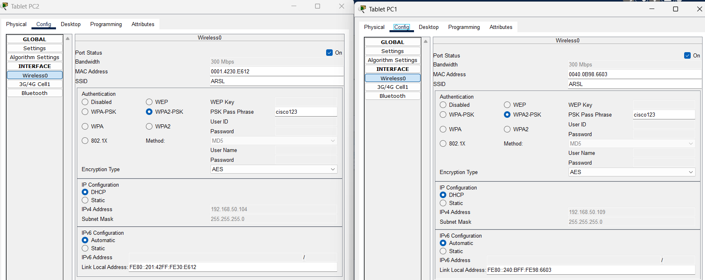

# ARSL-Tourism-Network-Design
Enterprise Network Design and Implementation using Cisco Packet Tracer
# ARSL Tourism & Booking Co. – Network Design

## Project Overview
This project presents the design and implementation of an enterprise network infrastructure for ARSL Tourism & Booking Co. using Cisco Packet Tracer.

The network is designed to connect different departments through a structured infrastructure, providing centralized network services and wired and wireless connectivity.

## Network Features
- Departmental VLAN Segmentation
- Router-on-a-Stick (ROAS)
- Inter-VLAN Routing
- VLAN Trunking
- Centralized DHCP Services
- Wireless LAN Controller (WLC)
- Lightweight Access Point (LAP)
- WPA2-PSK Wireless Security
- Network Connectivity Testing

## Network Departments
- Management
- Human Resources (HR)
- Information Technology (IT)
- Sales
- Clients

## Tools & Technologies
- Cisco Packet Tracer
- Cisco Routers and Switches
- VLANs and Trunking
- DHCP
- Wireless LAN Controller (WLC)
- Lightweight Access Point (LAP)

## Network Topology

## Network Configuration

### VLAN Configuration

### Router IP Interfaces

### DHCP Server Configuration

### Wireless Network Configuration

## Connectivity Testing

## Project Files

- `PROJECtArsl.pkt` – Complete Cisco Packet Tracer network simulation.
- `README.md` – Project overview and documentation.
- Configuration screenshots – Visual evidence of the network design and implementation.
