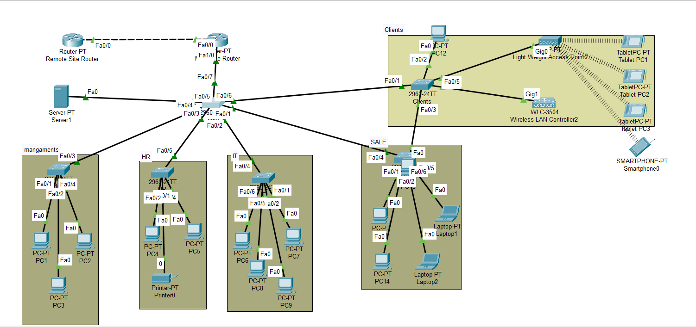
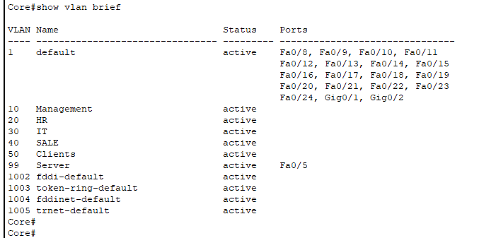
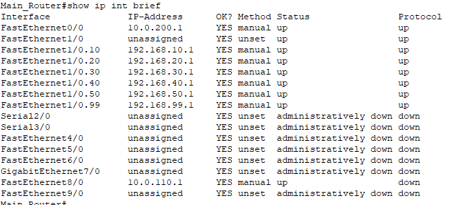
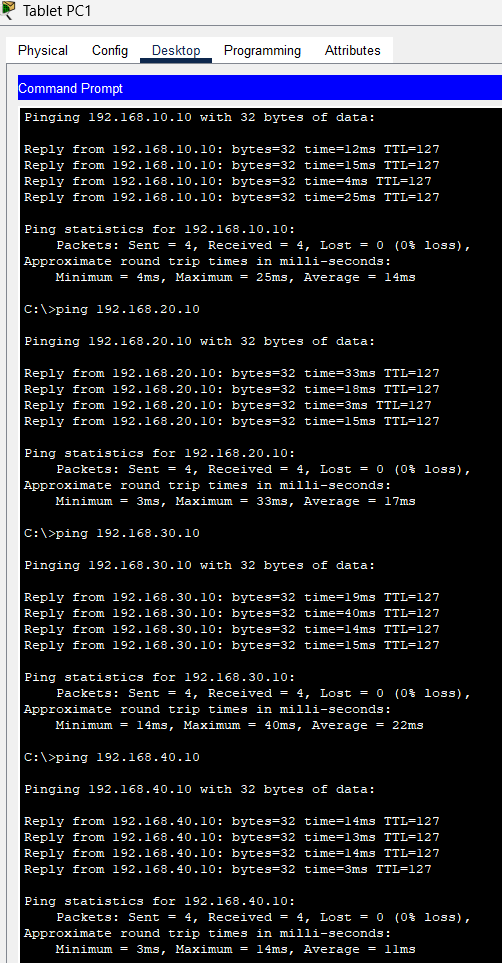

# ARSL-Tourism-Network-Design
Enterprise Network Design and Implementation using Cisco Packet Tracer
# ARSL Tourism & Booking Co. | Enterprise Network Design

## Project Overview

This project focuses on designing and implementing an enterprise network infrastructure for **ARSL Tourism & Booking Co.**, a tourism and reservation company.

The objective was to develop a structured and scalable network that connects the company's departments, supports centralized network services, and provides both wired and wireless connectivity.

The network was designed and simulated using Cisco Packet Tracer, incorporating VLAN segmentation, inter-VLAN routing, centralized DHCP services, and wireless network management.

## Network Architecture

The proposed network infrastructure consists of multiple departments connected through a centralized switching infrastructure.

The network includes:

- **Management:** Supports administrative operations.
- **Human Resources (HR):** Provides connectivity for HR employees and shared printing resources.
- **Information Technology (IT):** Supports technical operations and IT resources.
- **Sales:** Supports employees involved in sales and reservation operations.
- **Clients:** Provides network access for client devices, including wireless tablets and smartphones.
- **Centralized Server:** Provides DHCP services for the different network segments.
- **Remote Site:** Represented through an additional router connected to the main site infrastructure.

## Technologies & Implementation

### 1. VLAN Segmentation
Created separate VLANs for different departments to provide logical network segmentation and organize network traffic.

### 2. Router-on-a-Stick (ROAS)
Configured router sub-interfaces to enable communication between different VLANs through a single physical router interface.

### 3. Switching & Trunking
Configured access ports and trunk links to connect departmental switches and transport traffic from multiple VLANs.

### 4. Centralized DHCP Services
Configured a centralized DHCP server with multiple address pools for different network segments, allowing connected devices to obtain their IP configurations dynamically.

### 5. Wireless Network Infrastructure
Integrated a Cisco Wireless LAN Controller (WLC-3504) with a Lightweight Access Point (LAP) to provide centralized wireless network management.

Configured a wireless network using:
- SSID: ARSL
- WPA2-PSK Authentication
- AES Encryption
- Wireless client connectivity for tablets and smartphones.

### 6. Network Addressing & Routing
Configured IP addressing, subnet masks, default gateways, and router sub-interfaces to support communication between the network segments.

## Network Topology

The following diagram illustrates the complete network infrastructure, including departmental switches, routers, centralized server, and wireless components.

## Configuration Evidence

The following screenshots demonstrate selected configurations implemented during the project.

### VLAN Configuration
Displays the configured VLANs and their assigned switch ports.

### Router Interface Configuration
Shows router interface IP addresses and operational status, supporting the ROAS implementation.

### Centralized DHCP Configuration
Shows the DHCP service and address pools configured for Management, HR, IT, Sales, Clients, and the Server network.

### Wireless Network Configuration
Demonstrates the wireless client configuration, including the ARSL SSID, WPA2-PSK authentication, and wireless IP settings.

## Network Testing & Verification

Network functionality was evaluated through connectivity tests and configuration verification.

The testing activities included:

- Verifying communication between devices in different VLANs.
- Checking dynamic IP address allocation through DHCP.
- Verifying wireless client connectivity.
- Using ping commands to test communication between network devices.

### Connectivity Test Results

The following screenshot demonstrates successful connectivity testing.

## Challenges & Troubleshooting

During the implementation process, several technical issues required troubleshooting and configuration adjustments.

**1. DHCP Address Allocation**

Some devices initially experienced difficulties obtaining IP addresses. The DHCP pools, default gateways, subnet masks, and DHCP relay configuration were reviewed to ensure correct address allocation across the network.

**2. Wireless Connectivity**

Issues occurred during the initial connection between wireless clients and the network. The WLC, Lightweight Access Point, WLAN settings, and wireless authentication parameters were reviewed.

**3. Wireless Authentication**

An incorrect WPA2-PSK password prevented wireless devices from connecting. Correcting the authentication password restored successful wireless connectivity.

**4. Physical Connectivity and Interface Configuration**

Some network connections required troubleshooting due to incorrect cabling or interface configuration. Interface status and IP addressing were checked to restore connectivity.

These troubleshooting experiences strengthened the team's understanding of network configuration, fault isolation, and systematic problem-solving.

## Skills Demonstrated

- Enterprise Network Design
- Cisco Packet Tracer
- VLAN Configuration and Segmentation
- Router-on-a-Stick (ROAS)
- Inter-VLAN Routing
- Switch Trunking
- IP Addressing and Subnetting
- DHCP Configuration and Relay
- Wireless LAN Controller (WLC)
- Lightweight Access Point Configuration
- WPA2-PSK Wireless Security
- Network Testing and Troubleshooting

## Project Files

| File | Description |
|---|---|
| `PROJECtArsl.pkt` | Complete Cisco Packet Tracer network simulation |
| `README.md` | Project overview and technical documentation |
| `topology.png` | Complete network topology |
| `vlan_brief.png` | VLAN configuration |
| `ip_brief.png` | Router interface information |
| `server_pool.png` | Centralized DHCP configuration |
| `ping.png` | Network connectivity test results |
| `wireless.png` | Wireless configuration evidence |

## Conclusion

This project provided practical experience in designing, configuring, and troubleshooting an enterprise network environment.

By integrating VLAN segmentation, inter-VLAN routing, centralized DHCP services, and wireless network management, the project demonstrates the application of networking concepts to a realistic business scenario.

The implementation also strengthened practical skills in Cisco networking technologies, network administration, and troubleshooting.
